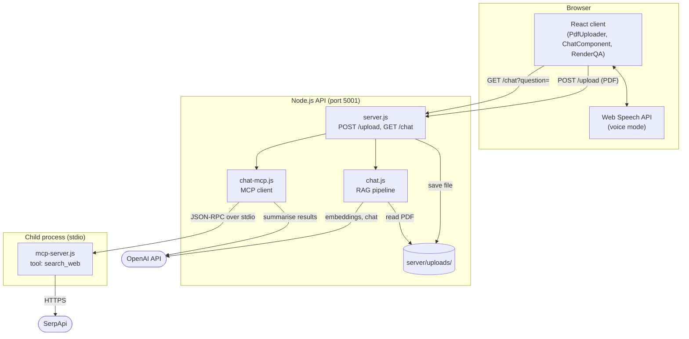
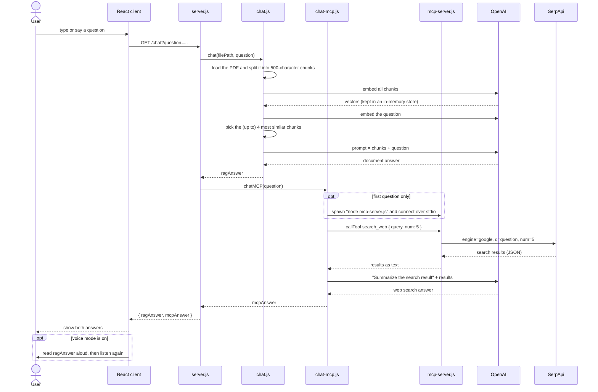

# Architecture

This page describes how the pieces of nextAI fit together and what happens when you ask a question.

## Components

| Component | Location | Responsibility |
| --- | --- | --- |
| React client | `src/` | Upload area, question input, answer list and the voice mode. Talks to the API over HTTP. |
| Express API | `server/server.js` | Two routes, `POST /upload` and `GET /chat`. Keeps the path of the latest uploaded file in memory. |
| RAG pipeline | `server/chat.js` | Loads the PDF, splits it, embeds the chunks, retrieves the best chunks for the question and asks the chat model. |
| MCP client | `server/chat-mcp.js` | Starts the MCP server as a child process on the first question, calls its search tool and asks the chat model to summarise the results. |
| MCP server | `server/mcp-server.js` | Exposes one tool, `search_web`, which queries SerpApi. Talks to the client over stdio. |
| OpenAI | external | Embeddings (`OpenAIEmbeddings`) and the chat model (`gpt-5`, used by both answers). |
| SerpApi | external | Google search results for the web search answer. |

## System overview

## What happens on `GET /chat`

The two answers are produced one after the other, not in parallel, so the response time is the sum of both.

## Design notes and limits

These follow from keeping the code close to the original project. They are worth knowing before you change or deploy it.

- **One document at a time.** The API remembers only the path of the last uploaded file, in a variable in the server process. A new upload replaces it for every client, and a restart forgets it.
- **No stored index.** Every question loads, splits and embeds the whole document again, so cost and latency grow with the size of the PDF. Nothing is cached between questions.
- **Search on every question.** The search tool is always called, once per question, and the model only summarises what it returns. The model does not decide whether to search.
- **Sequential answers.** The document answer finishes before the web search starts.
- **The search server is a child process.** It is started on the first question and reused afterwards. If an error is thrown while handling a question, the client is closed and a new child process is started on the next question. The child exits together with the API process.
- **Voice mode lives in the browser.** Speech recognition and speech synthesis use the Web Speech API on the client. The API never sees audio. Only `ragAnswer` is read aloud.
- **No authentication.** CORS is open (`cors()` with no options) and the routes are public.

### Failure behaviour

Measured on the current code with a local stand-in for the OpenAI API:

| Situation | Result |
| --- | --- |
| The web search fails (for example no network) | The search tool returns the error text instead of throwing. The model summarises that text, so the request succeeds with HTTP 200 and `mcpAnswer` contains it. |
| OpenAI rejects the request (for example with a wrong key) | The request throws at once, with no retries. Express 4 does not catch errors from `async` route handlers, so the API process exits within about a second. |
| OpenAI cannot be reached (measured with a refused connection) | The client retries for about 90 seconds, then the request throws and the API process exits as above. |
| The search server cannot be started | The request throws and the API process exits, as above. |
| `/chat` is called before any upload and `server/uploads/sample.pdf` does not exist | The request throws and the API process exits, as above. |
